# Testing report: `mcp_python_robot` (vmodal-robot MCP)

**Tester:** Magdalena Mišić
**Date:** 2026-11-06 to 2026-11-08
**Scope:** installation, connection to Claude Code, authenticated listing, and the local tools (format review, upload dry run, failure screen, telemetry repair, QC batch with video alignment, MCAP and LeRobot behaviour, format registration with `update_json_format_specs_from_file`) on the bundled sample episodes `ep_demo1` and `ep_demo2`.
**Not tested:** real uploads, indexing and search, and search (they write to the shared server and are waiting for a go-ahead, see section 7).

## 1. Summary

The installation and connection are smooth: one command, no errors, and the first telemetry prompt returned a clear result in about 14 seconds. The local tools give consistent numbers with each other.

The main problems are around the edges of the tools:

- **Undocumented dependencies**: the review, failure-screen and repair scripts need `numpy` (and `fire`, `filelock`, `pillow` in the scratch environment) that the installer does not provide.
- **The checks miss real defects in the sample data**: the upload dry run passes with 0 warnings even though the sample has a 9.0 A current spike and a `start_time` that is a year off from the telemetry.
- **The failure screen finds only part of the planted failure** in `ep_demo1`, and raises a false positive on `ep_demo2`.
- **The stock repair fixture crashes** on the bundled demo episodes (it expects at least 520 rows; they have 201).
- **`collection_list`** returns very large output with no filtering or pagination.
- **MCAP is not supported, and the error does not say so.** A `.mcap` file produces a `UnicodeDecodeError`, and the batch upload skips it silently.
- **The QC batch passes the repaired `ep_demo1` including video alignment**, but the stock repair fixture writes the wrong episode name into the telemetry header, so the validator rejects its output until the header is fixed by hand.
- **LeRobot v3 datasets work** (dry run passed with 0 errors).
- **Format registration works** (dry run writes nothing, real registration writes only local files), but there is no tool to undo it, and it modifies a git-tracked file.

Details, evidence and suggested fixes are below.

## 2. Environment

| Item | Value |
|---|---|
| OS | Ubuntu 24.04 (Lenovo ThinkBook 16 G6 ABP) |
| Python | 3.12.3 |
| Git | 2.43.0 |
| FFmpeg / ffprobe | 6.1.1 |
| Assistant | Claude Code 2.1.318 (Claude Pro) |
| Branch used | `docs/robot-mcp-beginner-readme` |
| Clone size | about 304 MiB (1236 objects, 2328 files) |

## 3. What was tested

| # | Step | Result |
|---|---|---|
| 1 | One-line install (`install_full.sh`) | Passed, local smoke test passed |
| 2 | Re-run of `install_full.sh` (retry) | Passed, idempotent |
| 3 | Connect to Claude Code | Passed, server listed as Connected |
| 4 | Telemetry draft prompt from the installer | Passed |
| 5 | Registration with `install_mcp.sh claude` and API key | Passed after correcting a key entry mistake on my side |
| 6 | `collection_list` | Passed (443 collections), see issues 4 and 5 |
| 7 | Format review skill on `ep_demo1` | 0 errors, 2 warnings, see issues 2, 3 |
| 8 | `robot_episode_upload(dry_run=true)` on `ep_demo1` | 0 errors, 0 warnings, see issue 6 |
| 9 | Failure screen skill on `ep_demo1` (with `ep_demo2` as peer) | 1 flag, see issue 7 |
| 10 | Telemetry repair fixture | Passed only after adapting the fixture, see issue 8 |
| 11 | `vmodal-robot-qc-batch` on repaired `ep_demo1` and `ep_demo2` | `ep_demo1` pass, `ep_demo2` reject, see 4.8 and issues 14, 17-20 |
| 12 | MCAP file through `robot_episode_upload` (dry run) | Not supported, unclear error, see 4.9 and issue 16 |
| 13 | LeRobot v3 dataset through `robot_dataset_upload` (dry run) | Passed, see 4.10 |
| 14 | Format list and binding for `robot_demo` | `xarm6_gripper_100hz@1` listed and bound, see issue 15 |
| 15 | `update_json_format_specs_from_file`: dry run, then real registration of a test format | Passed, see 4.11 and issues 21-24 |

## 4. Walkthrough with results

### 4.1 Installation and connection

The one-line command from README step 1 cloned the branch and ran the installer. The installer created `.venv-robot`, installed the package, passed the local telemetry smoke test and printed a ready MCP configuration. Re-running `bash install_full.sh` is safe: it reuses the environment and does not delete anything.

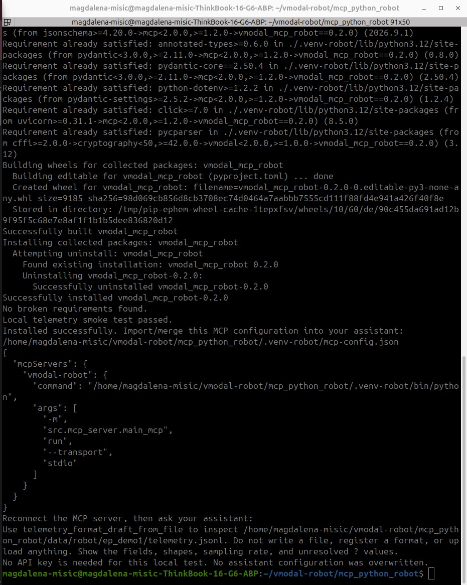

The server was connected with:

```bash
claude mcp add-json vmodal-robot '{"command":".../.venv-robot/bin/python","args":["-m","src.mcp_server.main_mcp","run","--transport","stdio"]}'
claude mcp list
```

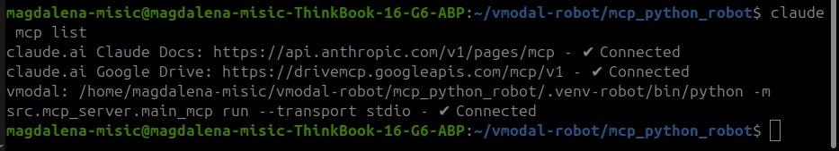

### 4.2 Telemetry draft (first test)

Prompt: `telemetry_format_draft_from_file` on `ep_demo1/telemetry.jsonl`, no output, no upload.

The tool returned: JSONL, time field `t_ns` (int64, nanoseconds, must increase), 100 Hz, seven required float fields (`q`, `current`, `cmd_q` with 6 joints, `gripper`, `cmd_gripper`, `ee_pos` with 3, `ee_quat` with 4 in xyzw), and a list of unresolved `?` values (ranges, tolerances, video alignment settings). Clear and useful.

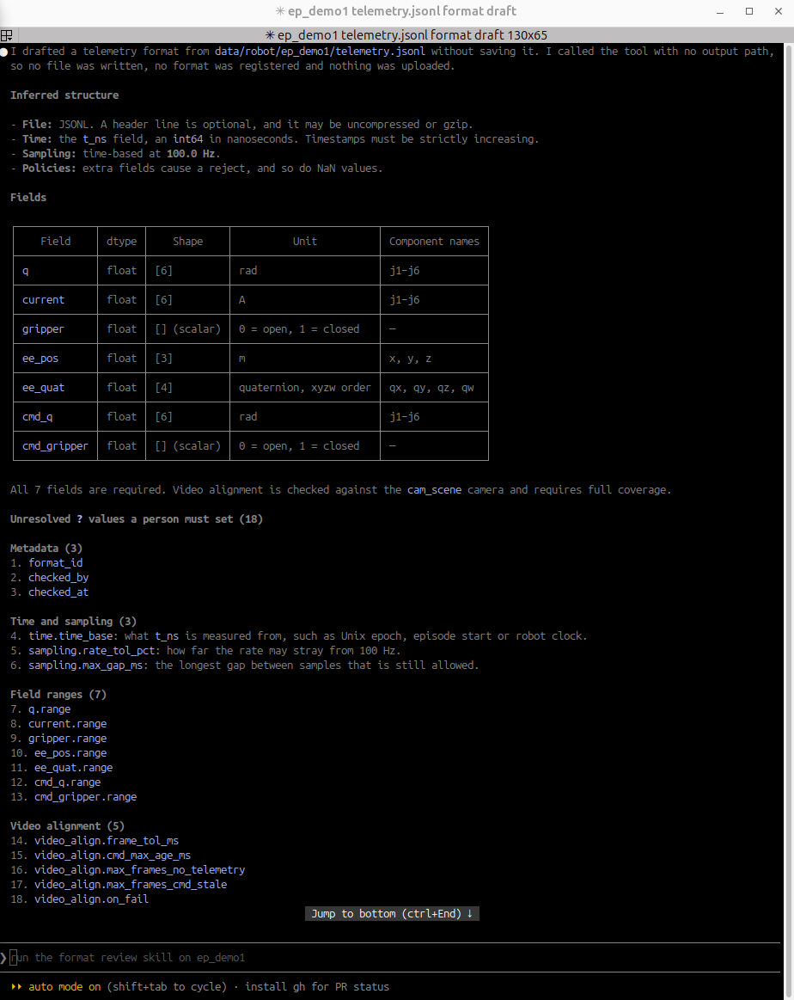

### 4.3 Authentication and `collection_list`

Before the key was set correctly, the server returned a clear message:
`AuthError (401): Only Clerk API keys are supported. Provide Authorization: Bearer <ak_...>.` This message is good and made the cause easy to find.

With a valid key, `collection_list` returned 443 collections (440 video, 3 image). 366 of them are auto-named test collections; 57 have no index version.

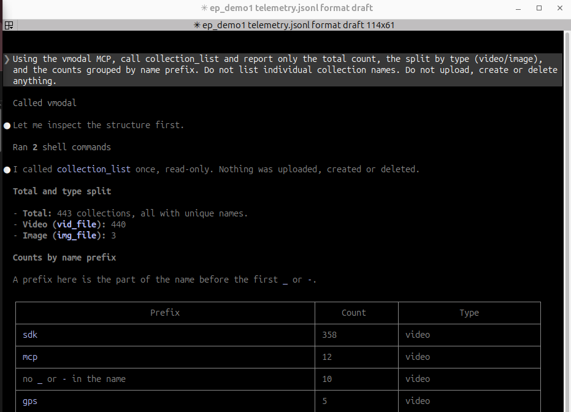

### 4.4 Format review skill (`ep_demo1`)

The skill was run twice on `ep_demo1`. Both runs found no errors. The script first reported 2 warnings (the `cmd_*` fields were not marked as commands; the remaining `?` values were open). The screenshot below is from the second run.

Measured values (same in both runs): 201 rows at 100 Hz (2.0 s), every sample gap exactly 10.0 ms, 60 scene frames at 29.95 fps, nearest telemetry sample to a frame at most 4.94 ms away (median about 2.5 ms), oldest command 9.95 ms, 0 frames without telemetry, 0 frames with a stale command. Gripper polarity matches its label (state follows the command by about 50 ms, correlation 0.96).

In the second run 13 of the 18 `?` values were filled from the data (format_id, time base, sampling tolerance and gap, ranges of `current`, `gripper`, `cmd_gripper`, `ee_pos`, `ee_quat`, and the four video alignment values). Five still need a person: `q.range` and `cmd_q.range` (every value in this sample is exactly 0.1, so the measured range would be [0.1, 0.1] and any real motion would fail), `video_align.on_fail` (a policy choice) and the sign-off fields `checked_by` and `checked_at`. The skill also states that the sample is a synthetic 2-second fixture, so ranges taken from it would reject normal real data.

The first run additionally pointed out two data problems: a single current spike (j2 reads 9.0 A at row 50, all other samples 0.3 A) and a `start_time` in the meta file that is one year off from the telemetry (2026 against 2025). The second run mentioned neither (see issue 12).

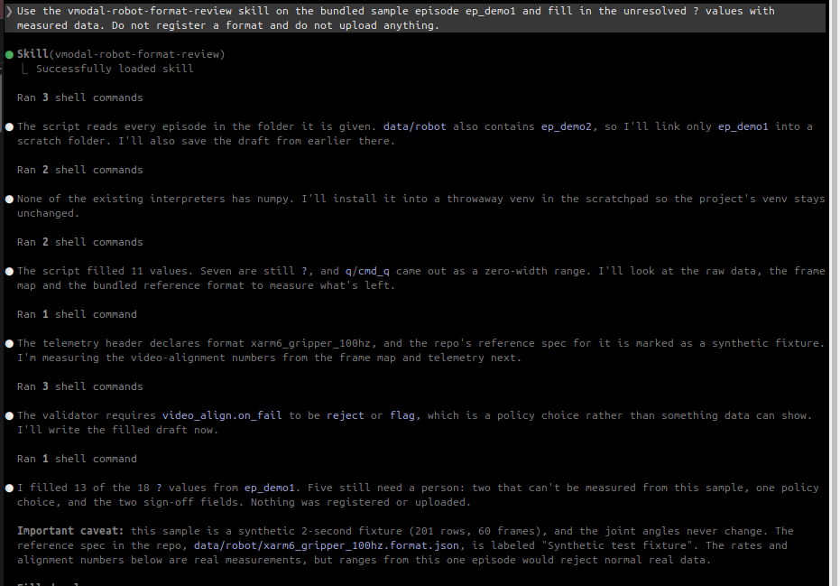

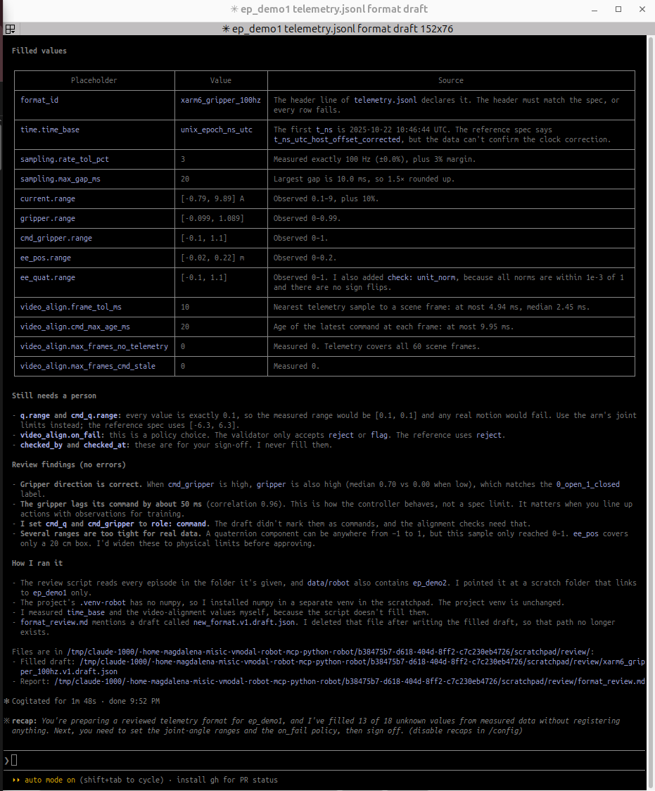

### 4.5 Upload dry run (`ep_demo1`)

`robot_episode_upload(dry_run=true)` with `robot_demo`, `dataset_rev=r1`: 0 errors, 0 warnings. Validated format, 201 rows with 0 bad rows, 100 Hz timing with no gaps, both cameras (60 frames, steady 30 fps), frame-to-telemetry alignment, command freshness. Nothing was uploaded; the dry run made no network calls and wrote local check files under `ztmp/mcp_robot/...` (this folder shows up as untracked in `git status`, see issue 13). The assistant also noted that the format used for the pass is a synthetic test fixture (`checked_by=synthetic_fixture`), so the pass shows that the pipeline works, not that a production format is approved, and that `success: false` in the meta file does not affect the verdict.

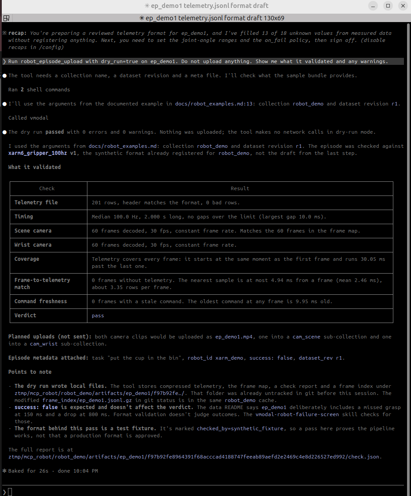

### 4.6 Failure screen (`ep_demo1`, `ep_demo2` as peer)

The screen flagged one item on `ep_demo1`: `not_released [medium]` (gripper still commanded closed in the last 0.5 s), with the suggestion `check` because it disagrees with `meta.success = False`.

The telemetry shows the planted failure more clearly than the screen does: the gripper closes almost fully at 150 ms (state 0.99, which suggests nothing between the fingers, a missed grasp), then opens to 0.70 at 800 ms while still commanded closed (a drop). The screen caught neither. The contact sheet of the scene camera cannot confirm it, because the videos are synthetic colour-bar test patterns.

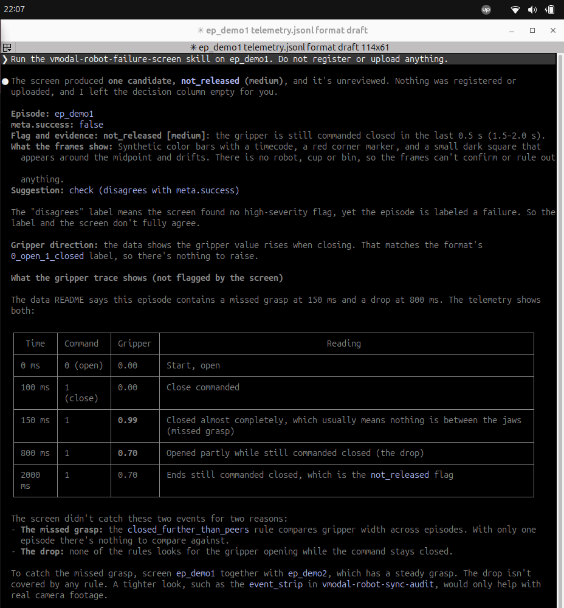

### 4.7 Telemetry repair fixture

After adapting the fixture (see issue 8), the result was as designed:

| Episode | Before | After | Changes | Unrepaired |
|---|---|---|---|---|
| `ep_demo1_corrupt` | reject (27 errors) | pass (0 errors) | 61 | 0 |
| `ep_demo2_broken` | reject (20 errors) | reject (20 errors) | 0 | 2 |

Repairs in `ep_demo1_corrupt`: out-of-order rows re-sorted, 5 duplicate timestamps dropped, 3 rows of missing `q` interpolated, 20 quaternions renormalized, 10 sign flips corrected, 4 `cmd_gripper` values clamped to 1, and one gap of about 70 ms filled with 6 inserted rows. The inserted rows look like real data and should be mentioned if the episode is used for training. In `ep_demo2_broken` the script correctly refused to repair: a run of 20 non-finite gripper values (limit 5) and a 310 ms gap (limit 150 ms).

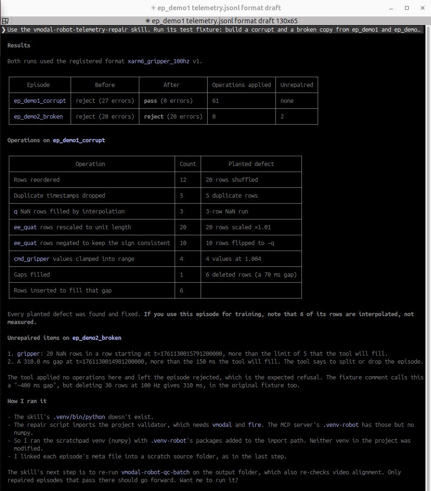

### 4.8 QC batch on the repaired episodes (including video alignment)

Skill `vmodal-robot-qc-batch`, dry run only, nothing uploaded or registered, outputs in a scratch folder. The run used the repair output with the episode name in the telemetry header corrected (see issue 14), so it is not a result of the repair tool alone.

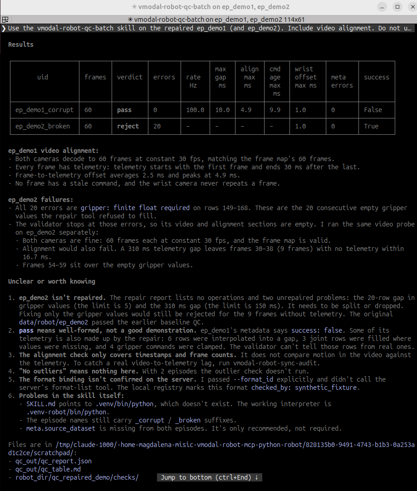

What it checks: telemetry rows (types, finite values, ranges, quaternion norm, increasing timestamps); timing (100 Hz within 10 percent, no gap over 20 ms); frame map; both cameras (constant 30 fps, frame count equal to the frame map); video to telemetry alignment (every frame needs a telemetry row within 16.7 ms and a command no older than 20 ms); metadata; outliers across the collection.

| Episode | Verdict | Errors | Rate | Max gap | Alignment max | Oldest command |
|---|---|---|---|---|---|---|
| `ep_demo1_corrupt` (repaired) | pass | 0 | 100 Hz | 10.0 ms | 4.9 ms | 9.9 ms |
| `ep_demo2_broken` (repaired) | reject | 20 | not checked | not checked | not checked | not checked |

- `ep_demo1`: both cameras decode to 60 frames at constant 30 fps, every frame has telemetry, no stale command. The numbers are identical to the unmodified `ep_demo1`, so the repair did not disturb alignment. The result is "well-formed", not "a good demonstration" (`success: false`).
- `ep_demo2`: 20 consecutive gripper values are not finite (rows 149-168), the repair limit is 5. The validator stops at these errors, so video and alignment are empty. A separate probe showed both cameras are fine, but a 310 ms telemetry gap (repair limit 150 ms) would leave 9 frames (30-38) without telemetry, so alignment would fail as well. Fixing only the gripper values would not be enough.
- Alignment compares timestamps and frame counts only. It cannot detect video that lags behind the robot in motion; the repo has a separate skill for that (`vmodal-robot-sync-audit`), which was not run.

### 4.9 MCAP files

The repo has no MCAP support in code. MCAP is mentioned only in the docs, which describe converting raw ROS 2 MCAP recordings to LeRobot v3 plus a 100 Hz telemetry sidecar before this tooling is used.

To see what a user would get, a 2.9 KB synthetic `telemetry.mcap` (30 messages with the `ep_demo1` fields, valid when read back) was passed to `robot_episode_upload(dry_run=true)` together with the other files of `ep_demo1`. The error, from calling the same function directly:

```
UnicodeDecodeError: 'utf-8' codec can't decode byte 0x89 in position 0: invalid start byte
```

It is raised in `os_rows_read` (`src/mcp_server/utils.py`), which has no MCAP branch and treats every unknown file as JSON lines. The message names neither MCAP nor the telemetry file, so it looks like a corrupt text file. Through the MCP tool the message should be the same, only without `error_type`/`status_code`, because `main_mcp.py` converts only `RobotError` and `SdkError` into the structured response (this is from reading the code, not from a run). `robot_dataset_upload` only looks for `.jsonl.gz`, `.jsonl`, `.json` and `.parquet`, so it would skip a `.mcap` file without any error (also from the code, not run).

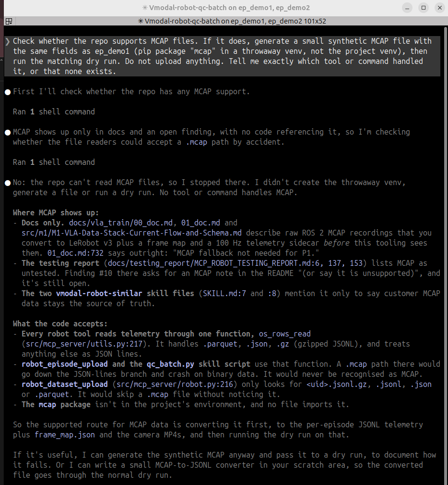

### 4.10 LeRobot dataset dry run

LeRobot v3 is supported through `robot_dataset_upload`, which cuts the episodes out of the shared video files and validates each one with `robot_episode_upload`. A tiny dataset with only `ep_demo1` (60 frames, both cameras at 30 fps) was built from the repo sample in `data/robot/lerobot/`. Run as a direct Python call with `dry_run=True` and a scratch output folder (the MCP tool runs the same function):

| Check | Result |
|---|---|
| Dataset setup (30 fps, episode table, frame map, video timing) | ok |
| Telemetry | 100 Hz, max gap 10 ms |
| Videos | both cameras 60 frames, constant 30 fps |
| Video to telemetry alignment | worst offset 4.9 ms (limit 16.7), oldest command 9.9 ms (limit 20) |
| Verdict | pass (n_pass 1, n_flag 0, n_reject 0) |

Supported: v3 layout at 30 fps, with `meta/info.json`, an episode table under `meta/episodes/`, and a vmodal frame map plus per-episode telemetry and metadata files. The original `ep_demo1` was used, because the sample frame map uses that name.

### 4.11 Format registration (`update_json_format_specs_from_file`)

Read from the code first (`src/mcp_server/robot_format.py`): the tool takes a spec file (no `?` left, `format_id` lowercase, `checked_by` and `checked_at` filled), optional `collection_name` and `sample_path`, and a `dry_run` flag. It writes only local files under `MCP_ROBOT_DIR`, with no call to the vmodal server. It has no unregister or unbind counterpart.

To test it without touching existing data, a copy of `xarm6_gripper_100hz.format.json` was registered under a new id, `magdalena_test_fmt` (version 1, `checked_by` set to `magdalena_test`), **without** `collection_name`, so no collection binding changed.

1. The first dry run was rejected: `header.format_id: differs from spec`. The header of the bundled `ep_demo1/telemetry.jsonl` names `xarm6_gripper_100hz`, and the validator does not accept a sample whose header differs from the spec (issue 21).
2. With a copy of the sample whose header `format_id` was changed (data rows identical), the dry run passed: 201 rows, 0 bad rows, 100.0 Hz, max gap 10 ms. It wrote nothing.
3. The real registration returned `status: created`, `bound_collection: null`. Afterwards `robot_demo` was still bound to `xarm6_gripper_100hz@1`, the other bindings were unchanged, and `magdalena_test_fmt@1` was listed.
4. Exactly one file was created and one modified: `ztmp/mcp_robot/formats/magdalena_test_fmt/v1.json` (new) and `ztmp/mcp_robot/formats/index.json` (a new entry). `index.json` is tracked in git, so `git status` shows it as modified.

The test format was removed afterwards by deleting its folder and restoring `index.json`.

## 5. Issues

| # | Severity | Where | Issue | Suggested fix |
|---|---|---|---|---|
| 1 | Medium | README step 2 and `install_mcp.sh` | README example names the server `vmodal-robot`, while `install_mcp.sh` registers `vmodal`. Following both steps leaves two servers pointing at the same program. | Use one name in both places, or make `install_mcp.sh` detect an existing entry. |
| 2 | High | Review, failure-screen and repair scripts | `numpy` is not installed by `install_full.sh`, and is not mentioned in the README. Neither `.venv-robot` nor the system Python has it. The repair run also needed `fire`, `filelock` and `pillow` in its scratch environment. The skills call `.venv/bin/python`, while the installer creates only `.venv-robot` (checked with `ls -d .venv*` in `mcp_python_robot`: only `.venv-robot` exists), so the command in the skill does not work after a fresh install. The assistant confirmed this in the second repair run ("The skill's .venv/bin/python doesn't exist"), and also that the repair script imports the project validator, which needs `vmodal` and `fire`, while `numpy` is missing from `.venv-robot`. | Add the dependencies to the package or an optional extra, and fix the interpreter path in the skills. |
| 3 | Medium | Format review script | For an episode where no joint moves, the suggested range for `q`/`cmd_q` was `[0.1, 0.1]`, which would reject any episode with real motion. A ±0.1 margin was also added to the gripper range. | Use the format header or the physical unit limits when the data has no variation. |
| 4 | Medium | `collection_list` | Output is too large to read directly (443 collections), with no filter or pagination. The assistant had to count them with shell commands. | Add filters (prefix, type, has index) and pagination. |
| 5 | Medium | `collection_list` | Some collections show a newest version higher than the number of listed versions (for example, one lists 2 versions with newest v12, another 14 with newest v15). The key also lists many collections whose names suggest unrelated projects. | Check version counting, and confirm that a user key should see only its own collections. (Names are left out of this report on purpose.) |
| 6 | High | Upload dry run | The dry run passes with 0 warnings even though `ep_demo1` has a single current spike (j2 reads 9.0 A at row 50, others 0.3 A) and the meta `start_time` (2026-10-22) is one year off from the telemetry (2025-10-22). The registered v1 format has no range for `current`, and the meta file is accepted as is. | Add a default range for `current`, and validate `start_time` against the first telemetry timestamp. |
| 7 | Medium | Failure screen | Only one weak flag on `ep_demo1`. The missed grasp is not caught because `closed_further_than_peers` needs more than two episodes. Nothing detects a gripper opening while it is commanded closed. `ep_demo2` (a steady successful grasp that starts already holding) gets a false `gripper_did_not_close [high]`. Also, the repo episode folders have no `meta.json`, which the script expects, so scratch copies were needed. | Add a rule for "opens while commanded closed", require the open state before the close command for `gripper_did_not_close`, and ship `meta.json` in the demo folders. |
| 8 | Medium | Repair fixture `make_corrupt.py` | Crashed with `IndexError` on the bundled demos in the first run, because it expects at least 520 telemetry rows and they have 201 (the summary of the second run does not mention it). A comment says the planted gap is about 400 ms, but it is 310 ms. | Pick defect positions as fractions of the episode length, and fix the comment. |
| 9 | Low | Dry run and review | The dry run reports using an "already registered" `xarm6_gripper_100hz` v1, while the format review says nothing was registered. It is not clear where v1 comes from. | Document where bundled formats are registered. |
| 10 | Low | README | MCAP is not covered in the README (confirmed unsupported, see issue 16). The README also does not show a step-by-step way to set `api_key` (for example `read -s`), which is easy to get wrong. | Add an MCAP note saying it is unsupported and must be converted first, and an `api_key` example. |
| 11 | Low | Sample data | The sample videos are synthetic colour-bar test patterns, so frames cannot confirm a grasp. `ep_demo1` is a fixture (`success: false`, joints stay at 0.1 rad). Tools check format and alignment but cannot judge whether an episode is useful. | State this clearly in the docs, or include one real short episode. |
| 12 | Medium | Format review skill | Results differ between runs on the same episode. In the first run the review pointed out the 9.0 A current spike and the one-year `start_time` mismatch. In the second run it set `current.range` to [-0.79, 9.89] ("observed 0.1-9, plus 10%"), which silently includes the spike, and mentioned neither problem. The number of values left open also differed (3 in the first run, 5 in the second). | Make the script itself flag outliers and meta/telemetry mismatches, so the result does not depend on how the assistant summarises it. |
| 13 | Low | Dry run | Dry-run artifacts are written inside the repository checkout (`ztmp/mcp_robot/...`), and this folder appears as untracked in `git status`. | Add `ztmp/` to `.gitignore`. |
| 14 | Medium | Repair fixture `make_corrupt.py` | The script renames the episode (to `ep_demo1_corrupt`) in `meta.json` and `frame_map.json` but leaves the old name in the telemetry header. The repair script does not compare names and reports "pass", while the upload validator stops with `episode_uid mismatch` before any check. It was fixed on a copy by changing only the header name (data rows byte-identical). | Write the new name into the telemetry header too, and make the repair script's own check compare the names. |
| 15 | Medium | README / server start | The MCP server looks for its store relative to the folder Claude Code was started in. Started from the home folder it looked in `~/ztmp/mcp_robot`, found no formats ("unregistered format: xarm6_gripper_100hz@1") and the project skills were not loaded. Started from `mcp_python_robot`, the format `xarm6_gripper_100hz@1` is listed and bound to `robot_demo`. | Say in the README that Claude Code must be started from `mcp_python_robot`, or set `MCP_ROBOT_DIR` in the registered server config. |
| 16 | Medium | `os_rows_read`, `robot_dataset_upload` | An unsupported telemetry file (tested with `.mcap`) gives `UnicodeDecodeError`, which does not name the format. In the batch upload such a file is skipped without any message. | Check the suffix in `os_rows_read` and raise `RobotError("unsupported telemetry format '.mcap'; convert to .jsonl/.jsonl.gz/.json/.parquet first")`, which the MCP layer already returns as a 422. Warn in the batch upload about skipped files. |
| 17 | Low | QC batch | The outlier check needs at least 5 episodes and is skipped silently with fewer. An empty outliers column means "not checked", not "no outliers". | Print "outliers: not checked (needs 5+ episodes)". |
| 18 | Low | `qc_batch.py` | It reads `check_report_path` from a result that only rejected episodes contain, so passing episodes have no report path. Episode duration is calculated as frames / 30 and not checked against the video. | Return the report path for every episode, and read the fps from the video. |
| 19 | Low | Repair and validator | Rows made up by the repair (6 interpolated, 3 filled joint rows, 4 clamped gripper commands in `ep_demo1`) cannot be told apart from measured rows afterwards. | Mark repaired rows (for example a flag column or a list in the check report), so training can exclude or weight them. |
| 20 | Low | `vmodal-robot-qc-batch` | The skill is silent about what happens when telemetry has errors: the validator stops there, so video and alignment are never evaluated for that episode, and the output shows empty cells. | Run the video probe even when telemetry fails, or state this clearly in the table. |
| 21 | Low | Format registration | A new spec cannot be tested against the bundled sample episodes: the dry run is rejected because the sample's header names the old format. A copy of the sample with a changed header was needed. | Allow checking a sample against a spec while ignoring the header id, or document the workaround. |
| 22 | Low | Format registration | `diff_vs_previous_version` lists every key as different when there is no earlier version. | Return an empty diff or "no previous version". |
| 23 | Medium | Format registration | There is no tool to undo a registration (unregister, delete, unbind). The binding of a collection is overwritten without a backup of the old value, and `dry_run` does not show that a binding would be replaced. Removing a format means deleting files and editing `index.json` by hand. | Add unregister/unbind, store the previous binding, and show binding changes in the dry run. |
| 24 | Low | Format registration | The registry `formats/index.json` is a git-tracked file, so every registration makes the checkout dirty and the change can be committed by accident. | Move the registry out of the tracked tree, or add it to `.gitignore`. |

## 6. Suggestions

1. Make the setup self-contained: dependencies included, one registered server name, one interpreter path.
2. Make the dry run stricter: default range for `current`, check `start_time` against telemetry, optional warning for "no motion in the episode".
3. Improve `collection_list`: filtering, pagination, and a check of what a user key may list.
4. Extend the failure screen with the two rules in issue 7 and a short test with three or more episodes.
5. Make test fixtures independent of episode length, and consistent in the episode name (issues 8 and 14).
6. Add a clear error for unsupported telemetry formats and a README note that MCAP must be converted (issue 16).
7. Document that Claude Code has to be started from `mcp_python_robot` or `MCP_ROBOT_DIR` has to be set (issue 15).

## 7. Not tested

- Real upload, indexing and search (only `collection_list` and the format list were called against the server). These write to a shared server with many existing collections, so they were not run without a go-ahead and a name for a test collection.
- LeRobot and MCAP were run as direct Python calls of the same functions, not through the MCP tool; the MCP-side error for MCAP is inferred from the code.
- `vmodal-robot-sync-audit` (motion-based video to telemetry lag).
- Windows (the installer targets macOS and Linux).

## 8. Appendix: commands used

```bash
git clone --branch docs/robot-mcp-beginner-readme --single-branch \
  https://github.com/arita37/vmodal_sdk_robotics_custom.git vmodal-robot
bash vmodal-robot/mcp_python_robot/install_full.sh
claude mcp add-json vmodal-robot '{...}'
claude mcp list
PYTHON_BIN="$PWD/.venv-robot/bin/python" bash install_mcp.sh claude   # with api_key set
```

Prompts given to the assistant:

- `Use telemetry_format_draft_from_file to inspect .../ep_demo1/telemetry.jsonl. Do not write a file, register a format, or upload anything.`
- `Using the vmodal MCP, call collection_list and show me the result. Do not upload, create or delete anything.`
- `Use the vmodal-robot-format-review skill on the bundled sample episode ep_demo1 ... Do not register a format and do not upload anything.`
- `Run robot_episode_upload with dry_run=true on ep_demo1. Do not upload anything.`
- `Run the vmodal-robot-failure-screen skill on ep_demo1. Do not register or upload anything.`
- `Use the vmodal-robot-telemetry-repair skill. Run its test fixture ... Do not register or upload anything.`
- `Use the vmodal-robot-qc-batch skill on the repaired ep_demo1 (and ep_demo2). Include video alignment. Do not upload or register anything. Report what it checks, what passes, what fails, and anything unclear.`
- `Generate a tiny synthetic .mcap file in a scratch folder (throwaway venv with the "mcap" package, not the project venv) and pass it to robot_episode_upload with dry_run=true. Do not upload anything.`
- `Check whether the repo supports LeRobot datasets. If it does, create a tiny synthetic LeRobot-style dataset from ep_demo1 in a scratch folder and run the matching dry run. Do not upload anything.`
- `Test update_json_format_specs_from_file safely: register a copy of the reference spec under the new id magdalena_test_fmt, first with dry_run=true, without collection_name.`
- `Call the vmodal MCP tool that lists formats and bindings ... Do not register or upload anything.`

Note: the later tests were run with Claude Code started from `~/vmodal-robot/mcp_python_robot`. Earlier runs from the home folder are described in issue 15.
